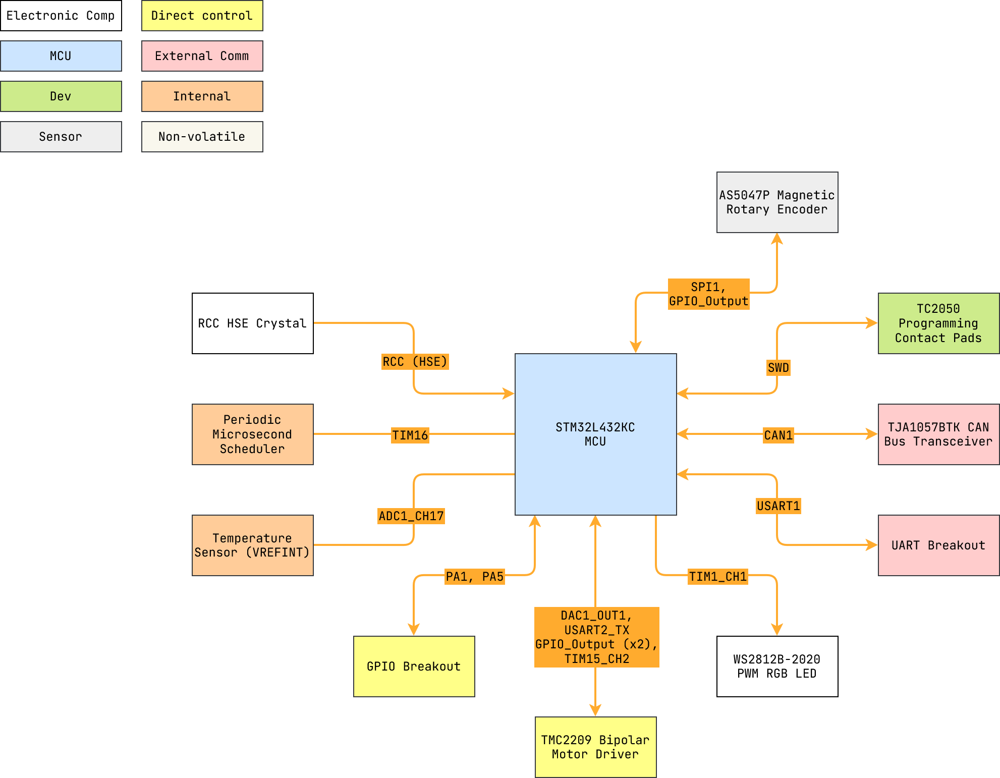

# mc_stepper


STM32L432KC microcontroller firmware for `mc_stepper_pcb`.

- CAN bus and UART enabled stepper motor.
- Closed-loop position and speed control.

---

<details markdown="1">
  <summary>Table of Contents</summary>

<!-- TOC -->
* [mc_stepper](#mc_stepper)
  * [1 Overview](#1-overview)
    * [1.1 Bill of Materials (BOM)](#11-bill-of-materials-bom)
    * [1.2 Block Diagram](#12-block-diagram)
    * [1.3 Pin Configurations](#13-pin-configurations)
    * [1.4 Clock Configurations](#14-clock-configurations)
  * [2 TMC2209 Bipolar Motor Driver](#2-tmc2209-bipolar-motor-driver)
    * [2.1 Background](#21-background)
    * [2.2 Universal Synchronous/Asynchronous Receiver/Transmitter (USART)](#22-universal-synchronousasynchronous-receivertransmitter-usart)
    * [2.3 Pulse Width Modulation (PWM) Timer](#23-pulse-width-modulation-pwm-timer)
      * [2.3.1 Timer Calculations](#231-timer-calculations)
      * [2.3.2 Nested Vectored Interrupt Controller (NVIC)](#232-nested-vectored-interrupt-controller-nvic)
  * [3 AS5147P Magnetic Rotary Encoder](#3-as5147p-magnetic-rotary-encoder)
    * [3.1 Background](#31-background)
  * [4 AB (Quadrature) Encoder](#4-ab-quadrature-encoder)
    * [4.1 Background](#41-background)
  * [Third-Party Licenses](#third-party-licenses)
<!-- TOC -->

</details>

---

## 1 Overview

### 1.1 Bill of Materials (BOM)

| Manufacturer Part Number | Manufacturer                         | Description             | Quantity | Notes |
|--------------------------|--------------------------------------|-------------------------|---------:|-------|
| STM32L432KC              | STMicroelectronics                   | 32-bit MCU              |        1 |       |
| TJA1057BTK               | NXP USA Inc.                         | CAN Bus Transceiver     |        1 |       |
| AS5147P                  | ams-OSRAM USA INC.                   | Magnetic Rotary Encoder |        1 |       |
| (External)               | (Various)                            | AB Quadrature Encoder   |        1 |       |
| TMC2209                  | Analog Devices Inc./Maxim Integrated | Bipolar Motor Driver    |        1 |       |
| WS2812B-2020             | (Various)                            | PWM Addressable RGB LED |        1 |       |

### 1.2 Block Diagram



> Drawio file here: [mc_stepper.drawio](docs/mc_stepper.drawio).

### 1.3 Pin Configurations

<details markdown="1">
  <summary>CubeMX Pinout</summary>


</details>

<details markdown="1">
  <summary>Pin & Peripherals Table</summary>

| STM32L432KC | Peripheral              | Config                     | Connection                       | Notes                                 |
|-------------|-------------------------|----------------------------|----------------------------------|---------------------------------------|
| PA14        | `SYS_JTCK-SWCLK`        |                            | TC2050 SWD Pin 4: `SWCLK`        |                                       |
| PA13        | `SYS_JTMS-SWDIO`        |                            | TC2050 SWD Pin 2: `SWDIO`        |                                       |
|             | `TIM16_CH1`             | PWM no output              | Scheduling                       | Scheduler.                            |
|             | `ADC1` `VREFINT`        | Scan conversion mode       | VDDA Sense                       | Configured in ADC1 rank 1.            |
|             | `ADC1_IN17`             | Scan conversion mode       | Temperature Sensor Channel       | Configured in ADC1 rank 2.            |
| PA10        | `USART1_RX`             | 115200 bps                 | `TX`                             |                                       |
| PA9         | `USART1_TX`             | 115200 bps                 | `RX`                             |                                       |
| PA11        | `CAN1_RX`               |                            | TJA1057BTK Pin 1: `TXD`          |                                       |
| PA12        | `CAN1_TX`               |                            | TJA1057BTK Pin 4: `RXD`          |                                       |
| PA15        | `GPIO_Output` (SPI1 CS) | Set high                   | AS5147P Pin 1: `CSn`             |                                       |
| PB3         | `SPI1_SCK`              |                            | AS5147P Pin 2: `CLK`             |                                       |
| PB4         | `SPI1_MISO`             |                            | AS5147P Pin 3: `MISO`            |                                       |
| PB5         | `SPI1_MOSI`             |                            | AS5147P Pin 4: `MOSI`            |                                       |
| PA1         | `TIM2_CH1`              | TIM2 encoder mode          | GPIO Breakout: (ie Encoder: `A`) | Reserved GPIO breakout (PA1).         |
| PA5         | `TIM2_CH2`              | TIM2 encoder mode          | GPIO Breakout: (ie Encoder: `B`) | Reserved GPIO breakout (PA5).         |
| PA4         | `DAC1_OUT1`             |                            | TMC2209 Pin 17: `VREF` circuit   |                                       |
| PA7         | `GPIO_Output`           | Hardware pull-up, set high | TMC2209 Pin 2: `ENN`             |                                       |
| PA2         | `USART2_TX`             | Single Wire (Half-Duplex)  | TMC2209 Pin 14: `PDN_UART`       |                                       |
| PA3         | `TIM15_CH2`             | Output Compare CH2         | TMC2209 Pin 16: `STEP`           |                                       |
|             |                         | Hardware GND               | TMC2209 Pin 9: `MS1`             |                                       |
|             |                         | Hardware GND               | TMC2209 Pin 10: `MS2`            |                                       |
| PA6         | `GPIO_Output`           | Set low                    | TMC2209 Pin 19: `DIR`            |                                       |
|             |                         | Hardware pull-down         | TMC2209 Pin 20: `STDBY`          |                                       |
| PA8         | `TIM1_CH1`              | PWM Generation CH1         | WS2812B-2020 Pin: `DIN`          | DIN pin number depends on IC variant. |

</details>

### 1.4 Clock Configurations

```
8 MHz High Speed External (HSE)
 -> Phase-Locked Loop Main (PLLM)
 -> 80 MHz SYSCLK
 -> 80 MHz HCLK
     -> 80 MHz APB1 (Maxed) -> 80 MHz APB1 Timer
     -> 80 MHz APB2 (Maxed) -> 80 MHz APB2 Timer
```

---

## 2 TMC2209 Bipolar Motor Driver

### 2.1 Background

### 2.2 Universal Synchronous/Asynchronous Receiver/Transmitter (USART)

UART is set in Single Wire (Half-Duplex), baud rate is set for 115200 bps.

### 2.3 Pulse Width Modulation (PWM) Timer

`TIM15_CH2` is configured as a Output Compare channel, using `Toggle on match`
mode.

`APB2`: 80 MHz (clock for `TIM15` PWM output channels).

#### 2.3.1 Timer Calculations

Given the PWM equation:

$$f_{PWM} = \frac{f_{TIM}}{ \left( ARR + 1 \right) \times \left( PSC + 1 \right) }$$

- $f_{TIM} = 1 \space \mathrm{MHz}$
    - Choosing 1 MHz (1 us per tick) to simplify calculations.
- $ARR = 65535$
    - Counter period.
- $f_{PWM} = 1 \space \mathrm{MHz}$
    - Aiming for 1 us ticks, or $1 \times 10 ^{-6} \space \mathrm{s}$.
    - Calculating for required PWM frequency:
        - $f_{PWM} = \frac{1}{1 \times 10 ^{-6} \space \mathrm{s}} = 1 \space \mathrm{MHz}$

Thus, the prescaler, $PSC = 80 - 1$.

#### 2.3.2 Nested Vectored Interrupt Controller (NVIC)

`TIM15` has its global interrupt enabled.

- As a side effect of the STM32L432KC architecture, `TIM1` break interrupt is
  also enabled (but not utilized).

---

## 3 AS5147P Magnetic Rotary Encoder

> **Note:** MC Stepper was originally developed with the AS5047P, however
> later development uses the AS5147P. Firmware is cross compatible for both the
> AS5047P/AS5147P, however source files maintain the use of the "AS5047P"
> naming.

### 3.1 Background

---

## 4 AB (Quadrature) Encoder

PA5 and PA1 are designated as GPIO breakouts, with default configration for a AB
quadrature encoder.

### 4.1 Background

The AB quadrature encoder is implemented via `TIM2` (16-bit) on the STM32L432KC.

Default configuration:

- 3.3 V logic signal.
- AB signals: Rising edge.
- AB low-pass input filter value: 4.

---

## Third-Party Licenses

This project uses the following open-source software components:

- **STM32Cube HAL**, STMicroelectronics.
    - Licensed under the `3-Clause BSD License`.
        - See [`LICENSE.txt`](Drivers/STM32L4xx_HAL_Driver/LICENSE.txt).

> STMicroelectronics are trademarks of their respective owners. Use of these
> names does **not** imply any endorsement by the trademark holders.
